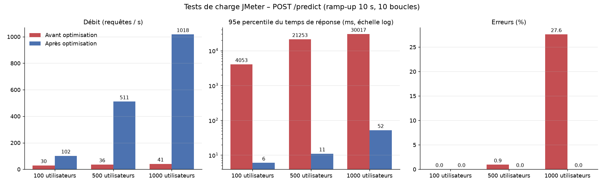
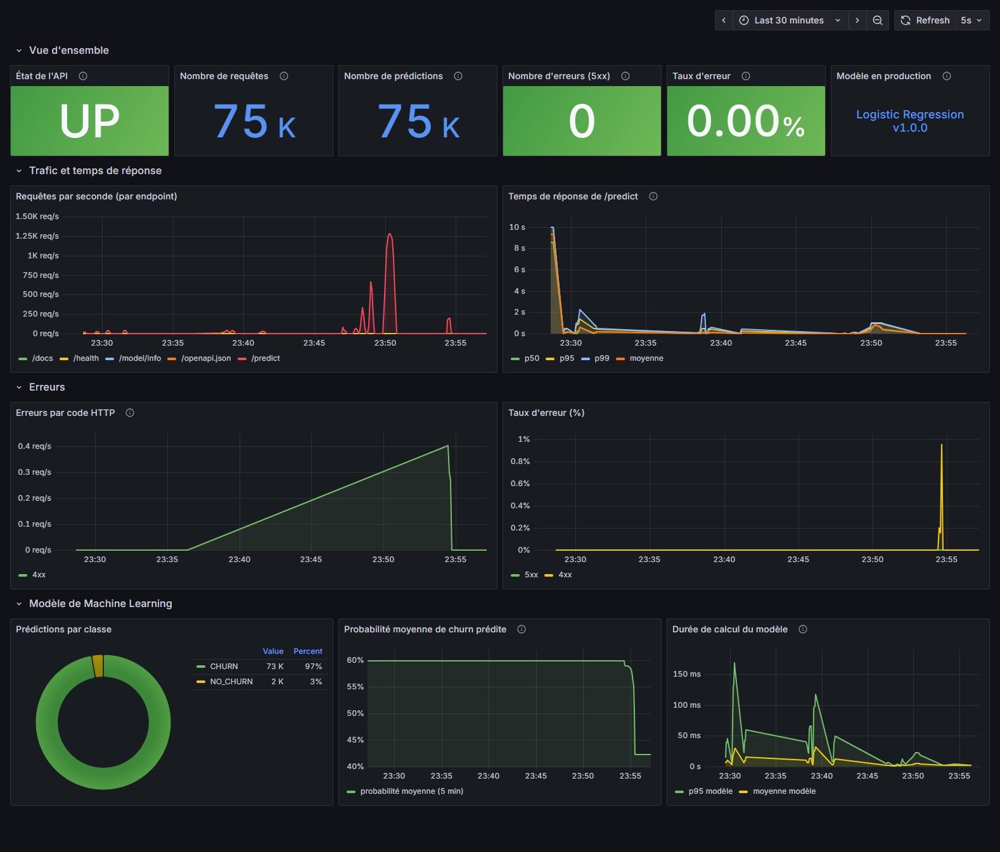
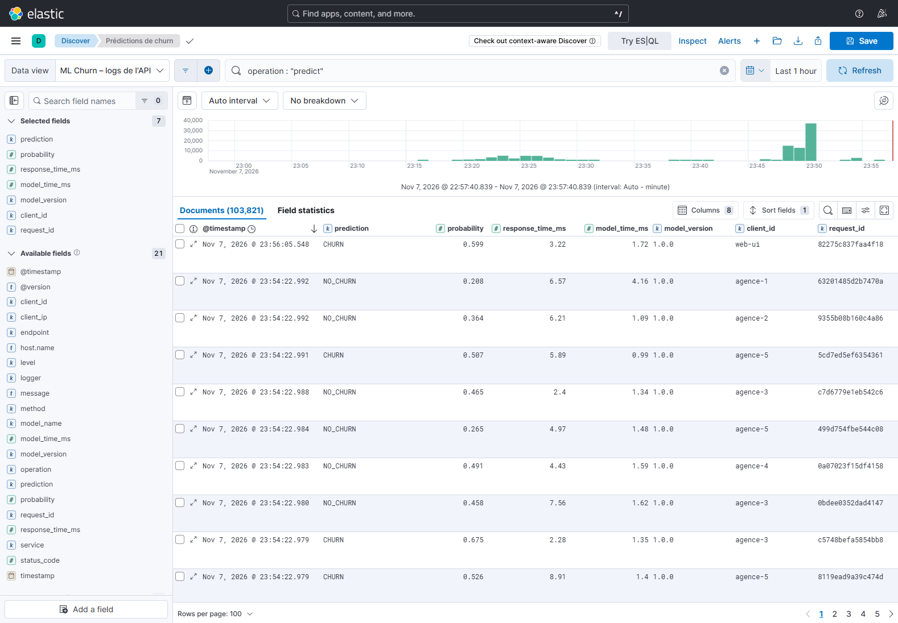

<!-- Conversion : npx @marp-team/marp-cli docs/PRESENTATION.md --pdf  (ou --pptx) -->

# Prédiction du churn télécom
## Du modèle de Data Science au service ML industrialisé

**Projet fil rouge MLOps** – Industrialisation du développement ML

Joe MAGNAN – MDSIA 2

---

## Le problème

- Un opérateur télécom perd des abonnés (**churn**) ; garder un client coûte moins cher qu'en acquérir un
- Objectif : estimer la **probabilité de résiliation** de chaque client pour cibler les actions de rétention
- **Classification binaire supervisée** – cible `churn` (0 / 1)
- 6 variables : âge, ancienneté, revenu, réclamations, montant mensuel, retards de paiement
- 2 000 clients générés (graine 42), **43 % de churn**

> Le livrable n'est pas « un modèle entraîné », mais un **service** déployable, testé, observable et maintenable.

---

## Architecture

```
 Utilisateur ─► Interface web (Nginx :8080) ─► FastAPI (:8000, 4 workers) ─► modèle v1.0.0
                                                  │
                     logs JSON ─► Logstash ─► Elasticsearch ─► Kibana (:5601)
                     /metrics  ─► Prometheus (:9090) ─► Grafana (:3000)

 Développeur ─► Git (feature → develop → main) ─► GitHub Actions
                 tests · E2E Selenium · build Docker + intégration · image GHCR
```

**8 services** dans un seul `docker-compose.yml`, configurations intégrées aux images

---

## Data Science : choisir le modèle sur des preuves

| Modèle | F1 (CV 5 plis) | ROC-AUC (CV) | F1 (test) |
|---|---|---|---|
| **Logistic Regression** | **0,523** | **0,655** | 0,510 |
| Decision Tree | 0,436 | 0,624 | 0,545 |
| Random Forest | 0,488 | 0,622 | 0,485 |

- Split 80/20 **stratifié** ; sélection en **validation croisée**, le test ne sert qu'à l'évaluation finale
- La régression logistique gagne : le générateur du sujet **est** une fonction logistique
- Signal faible par construction (ROC-AUC ≈ 0,65 au maximum)
- Le Random Forest du sujet reste disponible : `--model random_forest`

---

## MLOps : versionner et protéger la production

- `models/metadata.json` : version, date, métriques, variables, seuil, **SHA-256 des données**, versions des bibliothèques
- Registre local `models/registry/vX.Y.Z/` → **retour arrière** en une copie
- **Garde-fou qualité** : F1 < 0,45 → échec (CI rouge)
- **Non-promotion** : un modèle moins bon que la production est archivé, pas déployé
- La version est partout : `/model/info`, chaque réponse, chaque log, `churn_model_info`, tag de l'image Docker

---

## L'API FastAPI

| Endpoint | Rôle |
|---|---|
| `GET /health` | vivacité + modèle chargé (200 `UP` / 503 `DOWN`) |
| `GET /model/info` | modèle servi, version, métriques |
| `POST /predict` | `{"prediction": "CHURN", "probability": 0.599, "model_version": "1.0.0", "duration_ms": 0.9}` |
| `GET /metrics` | métriques Prometheus |
| `GET /docs` | Swagger UI |

Validation Pydantic (422), DataFrame aux noms de colonnes de l'entraînement, un seul `predict_proba`, utilisateur non root, healthcheck

---

## Tests : la pyramide

| Niveau | Outil | Nombre | Exemples |
|---|---|---|---|
| Unitaires | Pytest | 16 | dataset reproductible, contrôle du schéma, logs JSON, lanceur |
| API / intégration | Pytest + TestClient | 27 | 4 tests du sujet, 422, 503, 500, métriques, entraînement réel + garde-fou |
| E2E | Selenium (Chrome) | 4 | saisie → « Prédire » → résultat affiché |
| Stack | CI GitHub Actions | 1 job | compose → health, predict, proxy, Prometheus, Grafana |
| Charge | JMeter | 4 campagnes | 100 / 500 / 1000 utilisateurs + stress |

`pytest` → **43 passed** · `pytest -m e2e` → **4 passed**

---

## CI/CD GitHub Actions

1. **tests** : dataset (contrôle de reproductibilité) → entraînement avec garde-fou → pytest + couverture
2. **e2e** : API sur le runner + Selenium headless
3. **docker** : build, stack api + interface + Prometheus + Grafana, tests d'intégration
4. **publish** (`main`) : image `ghcr.io/joemagnan/ml-churn-api:{latest, 1.0.0, sha}`

Flux Git : `feature/*` → **Pull Request** → `develop` → `main`

---

## Tests de charge : le choc



Première série : **41 req/s, p95 = 30 s, 27,6 % d'erreurs** à 1000 utilisateurs… alors que le modèle répond en 3 ms

---

## Diagnostic : mesurer avant d'optimiser

| Configuration (20 clients simultanés) | Débit |
|---|---|
| Image initiale | 49 req/s |
| Sans logs | 166 req/s |
| `uvicorn --workers 2` | 21 req/s en séquentiel : **48 ms constants** |
| **Image finale** | **998 req/s** |

1. **Un seul processus** (GIL) : 1 cœur utilisé sur 22
2. **Logs coûteux** : 3 lignes par prédiction, écrites de façon synchrone
3. **Nagle + ACK retardé** : en multi-workers, les connexions n'avaient pas `TCP_NODELAY`

→ `api/serve.py` (4 workers + `TCP_NODELAY`), 1 ligne de log par requête, Prometheus multiprocessus

---

## Résultat

| 1000 utilisateurs | Avant | Après |
|---|---|---|
| Débit | 41 req/s | **1 018 req/s** |
| Médiane | 22,7 s | **11 ms** |
| p95 | 30,0 s | **52 ms** |
| Erreurs | 27,6 % | **0 %** |

**Stress** (1000 × 50 = 50 000 requêtes) : saturation à **1 150 req/s**, p95 = 897 ms, **0 erreur**
→ dégradation propre ; latence ≈ 1000 / 1150 ≈ 0,87 s (loi de Little)

---

## Observabilité : métriques (Prometheus + Grafana)



Requêtes, temps de réponse p50/p95/p99, erreurs, taux d'erreur, prédictions par classe, dérive · 4 alertes

---

## Observabilité : logs (Logstash + Elasticsearch + Kibana)



Une ligne JSON par requête : **quand, qui, quelle opération, quel modèle, quel résultat, combien de temps, quelle erreur** – sans donnée personnelle

---

## Corrections apportées au sujet (extraits)

- `pytest` seul ne trouvait pas `api` → `pytest.ini`
- CI sans modèle ni données → génération + entraînement avant les tests
- `assert "FastAPI" in driver.title` toujours faux → titre « Swagger UI »
- Grafana lancé hors du compose → ne voyait pas Prometheus
- `COPY . .` en root → image ciblée, non root, healthcheck
- `plt.show()` bloquant, chemins relatifs, CSV différent Windows/Linux
- `predict` + `predict_proba`, version en dur ×3, aucune validation
- `git config` au nom de l'enseignant

18 corrections détaillées dans le rapport d'industrialisation

---

## Limites et suite

- Données synthétiques au signal faible ; sur données réelles : **seuil métier**, équité
- **MLflow Model Registry** + **DVC** à la place du registre local
- Dérive complète (Evidently) + suivi de la précision réelle (labels différés)
- Sécurité : X-Pack ELK, HTTPS, authentification de l'API, limitation de débit
- Alertmanager pour notifier ; test d'**endurance** ; montée en charge horizontale (`--scale api=N`)
- Déploiement sur VM cloud : script prêt (`deploy/deploy.sh`)

---

# Merci

> « J'ai développé un modèle de Machine Learning, je l'ai exposé sous forme d'API, testé automatiquement, versionné avec Git, conteneurisé avec Docker, intégré dans une chaîne CI/CD, soumis à des tests de charge et placé sous observabilité grâce aux logs, aux métriques et aux dashboards. »

Dépôt : **github.com/Joemagnan/ml-churn-project**

Questions ?
