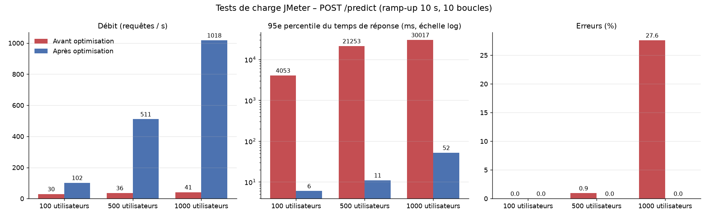
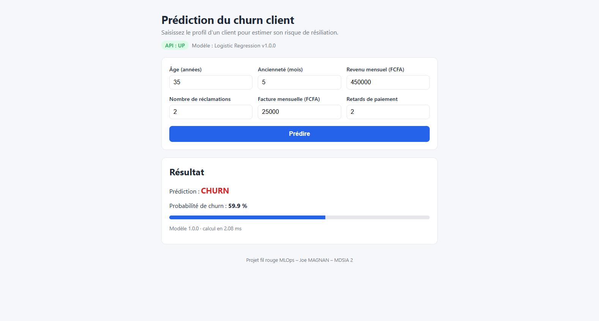
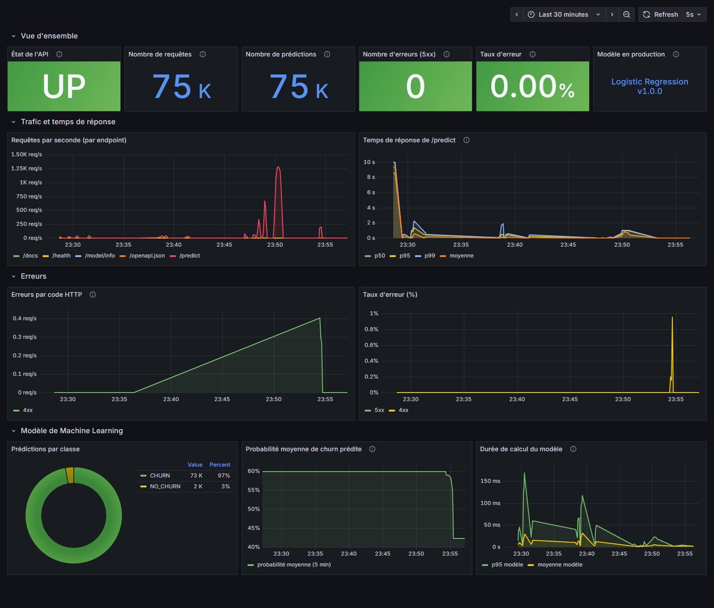
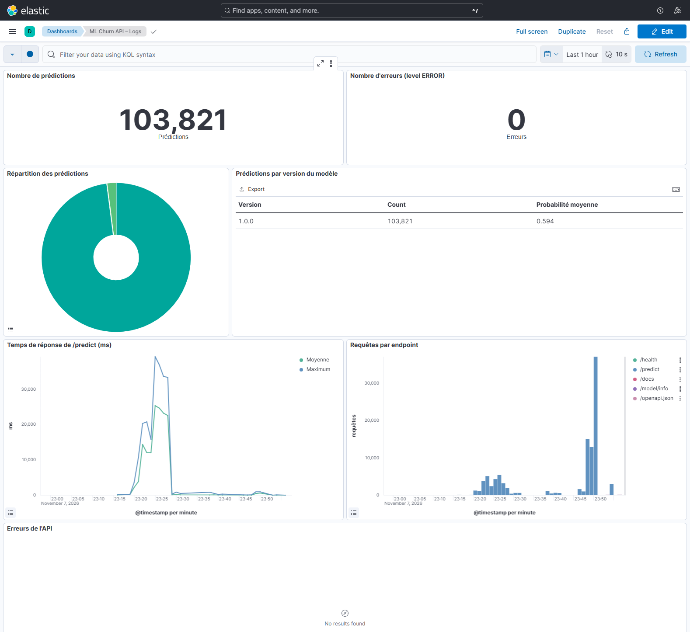
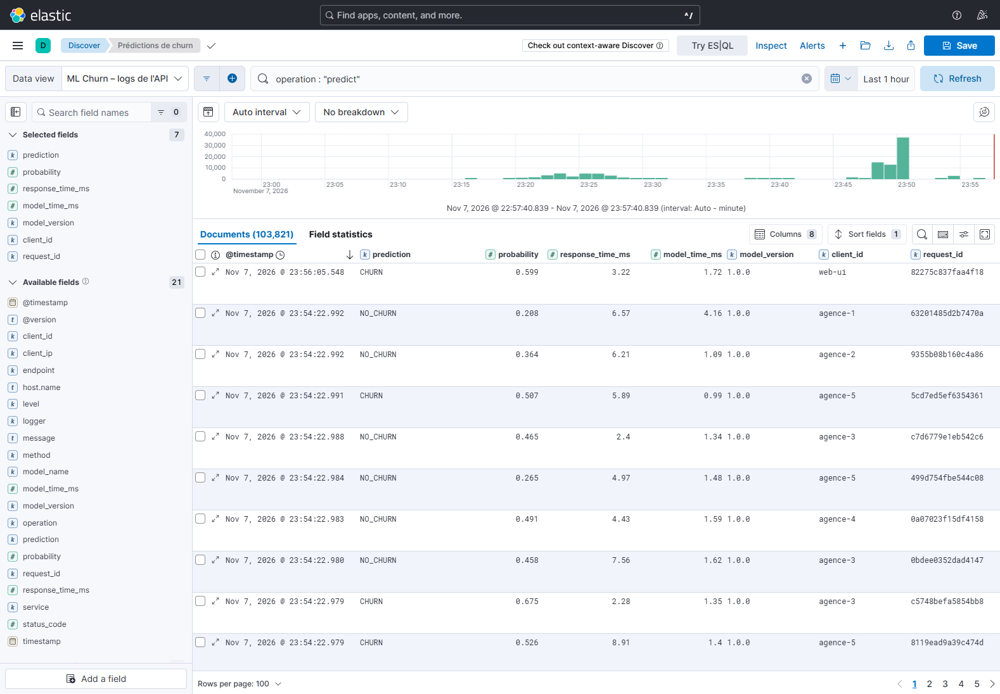
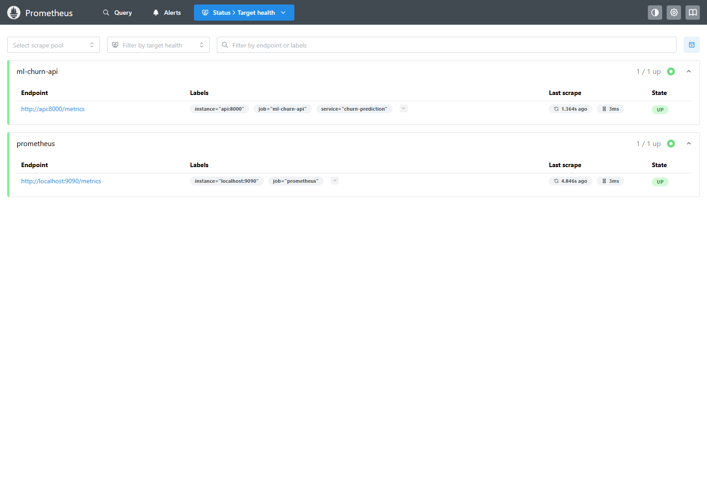
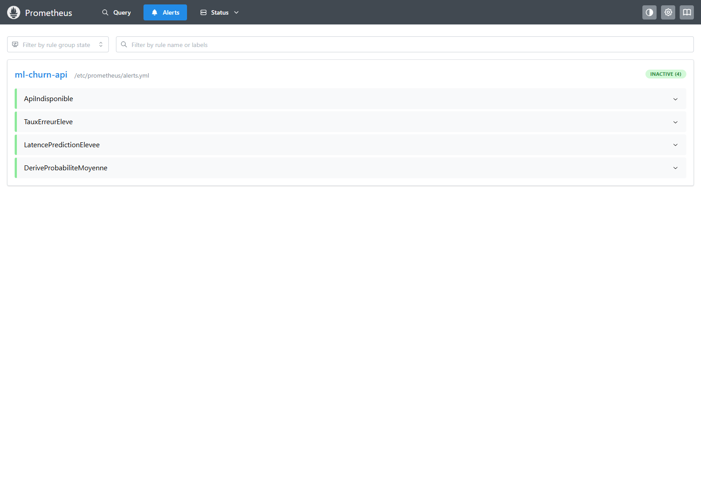
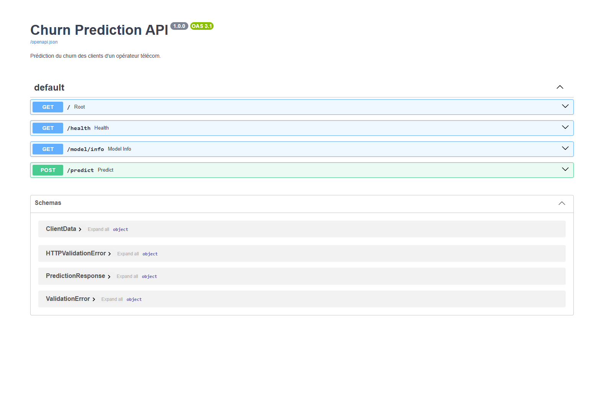

# Rapport d'industrialisation

**Projet fil rouge MLOps – prédiction du churn d'un opérateur télécom**
Joe MAGNAN – MDSIA 2 – module « Industrialisation du développement ML »

---

## 1. Objectif

Transformer un modèle de Machine Learning développé en environnement Data Science
en un service **déployable, testable, monitoré et maintenable** : API, tests
automatiques, versionnement Git, conteneurisation, CI/CD, tests de charge, logs
centralisés, métriques et dashboards.

Le sujet fournit le code de chaque étape et demande de « suivre les directives et
d'apporter les corrections nécessaires ». Ce rapport décrit ce qui a été construit,
les erreurs corrigées dans le code fourni et les mesures obtenues, en particulier
celles des tests de charge, qui ont conduit à une optimisation importante de l'API.

## 2. Ce qui a été livré

| Étape du sujet | Réalisation | Vérification |
|---|---|---|
| 1–3 Environnement | arborescence du sujet, venv Python 3.12, dépendances figées | `pip install -r requirements-dev.txt` |
| 4 Dataset | générateur du sujet (graine 42), CSV versionné | test de reproductibilité en CI |
| 5 Exploration | script du sujet corrigé + notebook exécuté | 6 figures |
| 6 Entraînement | 3 modèles, validation croisée, versionnement, garde-fou | 3 tests d'intégration |
| 7–10 API | FastAPI : `/`, `/health`, `/model/info`, `/predict`, `/metrics`, Swagger | 24 tests API |
| 11 Pytest | 43 tests (unitaires, API, logs, modèle, lanceur) | `pytest` : 43 passed |
| 12–13 Git / GitHub | branches `main`, `develop`, `feature/*`, Pull Request | historique du dépôt |
| 14–15 Docker | image non root avec healthcheck, compose de 8 services | `docker compose ps` |
| 16 CI | GitHub Actions : tests, E2E, Docker + intégration, publication GHCR | onglet Actions |
| 17 Selenium | 4 tests E2E sur une vraie interface web | `pytest -m e2e` : 4 passed |
| 18 JMeter | plan paramétrable, campagnes 100 / 500 / 1000 utilisateurs + stress | section 6 |
| 19–20 Logs / ELK | logs JSON, Logstash, Elasticsearch, dashboard Kibana importé | section 5 |
| 21–22 Prometheus / Grafana | métriques HTTP et métier, 4 alertes, dashboard de 13 panneaux | section 5 |
| 25 Déploiement | script `deploy/deploy.sh` (VM Ubuntu) | voir section 8 |

## 3. Corrections apportées au code du sujet

| Partie | Problème constaté | Conséquence | Correction |
|---|---|---|---|
| 4 | chemins relatifs au dossier courant ; fins de ligne CRLF sous Windows | script inutilisable hors de la racine ; CSV différent selon l'OS | chemins absolus ; `lineterminator="\n"` ; CI : `git diff --exit-code data/raw/churn.csv` |
| 5 | `plt.show()` | bloque le script ; plante sans écran (CI, Docker) | figures enregistrées ; `--show` pour les afficher |
| 6 | Random Forest gardé d'office | choix non justifié, et en fait pas le meilleur | validation croisée 5 plis, choix sur le F1 moyen |
| 6 | aucun suivi des versions | impossible de savoir quel modèle tourne, ni de revenir en arrière | `metadata.json`, registre `models/registry/vX.Y.Z`, garde-fou qualité |
| 7 | `model.predict([[...]])` sur une liste | avertissement scikit-learn ; dépend de l'ordre des champs | DataFrame avec les noms de colonnes d'entraînement |
| 7 | `predict` puis `predict_proba` | modèle calculé deux fois | un seul `predict_proba`, classe déduite du seuil |
| 7 | version « 1.0.0 » écrite en dur 3 fois | incohérence garantie à la prochaine version | lue dans `metadata.json` |
| 7 | aucune validation ; `joblib.load` au démarrage sans contrôle | âge négatif accepté ; plantage si le modèle manque | contraintes Pydantic (422) ; `/health` en 503 `DOWN` |
| 11 | `from api.main import app` avec `pytest` seul | `ModuleNotFoundError` (notamment en CI) | `pytest.ini` : `pythonpath = .` |
| 12 | `git config` avec le nom de l'enseignant | commits attribués à la mauvaise personne | identité de l'auteur, configurée dans le dépôt |
| 14 | `COPY . .`, exécution en root | image lourde (venv, .git, données) ; surface d'attaque | `.dockerignore`, copie ciblée, utilisateur `appuser`, HEALTHCHECK |
| 15 / 22 | Grafana lancé seul avec `docker run` | il ne peut pas joindre `prometheus:9090` | tout est dans le même docker-compose |
| 16 | la CI lance `pytest` sans données ni modèle | échec sur un runner propre | génération + entraînement avant les tests |
| 17 | `assert "FastAPI" in driver.title` | échoue toujours : le titre est « Churn Prediction API - Swagger UI » | assertion corrigée |
| 17 | `tests/test_selenium.py` collecté par `pytest` | casse la CI (ni serveur ni navigateur) | marqueur `e2e`, job CI dédié |
| 19 | logs texte avec `print` | inexploitables dans Kibana | logs JSON structurés |
| 20 | compose ELK et configuration Logstash absents | partie impossible à exécuter telle quelle | pipeline, template d'index, dashboard importé |
| 3 | `pip freeze > requirements.txt` sous Windows | outils de dev dans l'image | `requirements.txt` / `requirements-dev.txt` |

Deux problèmes sont apparus en cours de route, indépendamment du sujet :
- **Docker Desktop ne partageait pas le disque D:** : les fichiers de configuration
  montés (`./monitoring/prometheus:/etc/prometheus`) arrivaient vides dans les conteneurs.
  Toutes les configurations sont désormais **intégrées dans des images** construites par
  le compose. C'est plus robuste, et c'est aussi ce qu'on fait en production
  (configuration immuable et versionnée avec l'image).
- **Les performances de l'API**, détaillées en section 6.

## 4. Data Science

Les données générées ont un **signal faible par construction** : le churn est tiré au
hasard avec une probabilité comprise entre 20 % et 70 % selon le profil. La variable
dominante est l'ancienneté (corrélation −0,25), suivie du montant mensuel (+0,12).
L'âge et le revenu n'ont aucun effet, et celui des réclamations est trop faible pour
être visible sur 2 000 clients.

| Modèle | F1 (CV 5 plis) | ROC-AUC (CV) | F1 (test) | ROC-AUC (test) | Accuracy (test) |
|---|---|---|---|---|---|
| **Logistic Regression** | **0,523** | **0,655** | 0,510 | 0,636 | 0,625 |
| Decision Tree (profondeur 5) | 0,436 | 0,624 | 0,545 | 0,623 | 0,633 |
| Random Forest (200 arbres) | 0,488 | 0,622 | 0,485 | 0,625 | 0,603 |

La **régression logistique** est retenue : meilleure en validation croisée, ce qui est
cohérent avec un générateur lui-même logistique, et elle est bien plus légère que le
Random Forest (fichier de 1,8 Ko, prédiction en environ 1 ms). L'arbre de décision a
le meilleur F1 *sur le jeu de test*, mais le plus mauvais en validation croisée : sur
400 clients, c'est du hasard. Cela illustre pourquoi le jeu de test ne doit pas servir
à choisir le modèle.

## 5. Observabilité

**Logs** : une ligne JSON par requête (quand, qui, quelle opération, quel modèle, quel
résultat, combien de temps), plus une ligne ERROR avec la trace en cas d'erreur du
modèle. Aucune donnée personnelle n'est journalisée. Chaîne : fichier `api-<pid>.log`
sur un volume partagé → Logstash → index quotidien `ml-churn-logs-*` → Kibana
(dashboard « ML Churn API – Logs » : prédictions, erreurs, répartition CHURN/NO_CHURN,
versions du modèle, temps de réponse, requêtes par endpoint). Pendant les tests, plus
de 46 000 prédictions ont été indexées et consultables.

**Métriques** : `/metrics` expose les métriques HTTP de l'Instrumentator (requêtes,
codes, latence par endpoint) et des métriques métier : prédictions par classe et par
version, erreurs du modèle, latence du modèle, distribution des probabilités prédites.
Prometheus les collecte toutes les 5 s et évalue 4 règles d'alerte (API indisponible,
plus de 5 % de 5xx, p95 > 500 ms, dérive de la probabilité moyenne). Le dashboard
Grafana « ML Churn API – Monitoring » est provisionné automatiquement ; il couvre les
5 indicateurs demandés (requêtes, temps de réponse, erreurs, taux d'erreur,
prédictions) et ajoute l'état de l'API, la version du modèle et un indicateur de dérive.

Captures : voir l'annexe.

## 6. Tests de charge et optimisation

### 6.1 Protocole

Plan JMeter du sujet : `POST /predict` avec le client d'exemple, ramp-up 10 s,
10 boucles par utilisateur, assertions sur le code 200 et la présence du champ
`prediction`. Campagnes à 100, 500 et 1000 utilisateurs, lancées en ligne de commande
(`jmeter -n`) depuis le poste Windows vers l'API dans Docker Desktop (22 cœurs, 32 Go).

### 6.2 Première série : l'API ne tient pas la charge

| Utilisateurs | Requêtes | Moyenne | Médiane | p90 | p95 | p99 | Débit | Erreurs |
|---|---|---|---|---|---|---|---|---|
| 100 | 1 000 | 2 541 ms | 2 399 ms | 3 791 ms | 4 053 ms | 4 337 ms | 29,5 req/s | 0 % |
| 500 | 5 000 | 13 298 ms | 12 922 ms | 20 357 ms | 21 253 ms | 21 782 ms | 36,0 req/s | 0,94 % |
| 1000 | 10 000 | 22 757 ms | 22 742 ms | 30 014 ms | 30 017 ms | 30 024 ms | 41,3 req/s | **27,6 %** |

Le débit plafonne autour de 30 à 40 req/s, quel que soit le nombre d'utilisateurs :
les requêtes s'accumulent dans la file d'attente et le temps de réponse grimpe jusqu'au
délai d'attente de JMeter (30 s). À 1000 utilisateurs, 2 356 requêtes expirent
(`SocketTimeoutException`) et 404 connexions sont refusées (file d'attente TCP pleine).
Or le modèle seul calcule une prédiction en environ 3 ms : le problème n'est donc pas
le Machine Learning.

### 6.3 Diagnostic

Mesures avec un client HTTP en keep-alive, depuis l'intérieur du conteneur (pour
écarter le réseau de Docker Desktop), 20 clients simultanés :

| Configuration testée | Séquentiel | 20 clients | Durée du modèle (20 clients) |
|---|---|---|---|
| Image initiale (1 processus, logs fichier + sortie standard) | 128 req/s | **49 req/s** | 14,5 ms |
| Sans aucun log | 127 req/s | 166 req/s | 3,3 ms |
| Logs dans le fichier seulement | 106 req/s | 138 req/s | 3,7 ms |
| `uvicorn --workers 2` | **21 req/s (48 ms constant)** | 135 req/s | 4,3 ms |
| 4 workers + `TCP_NODELAY` | 357 req/s | 637 req/s | 1,5 ms |
| **Image finale** (4 workers, `TCP_NODELAY`, 1 ligne de log, sans log d'accès) | **415 req/s** | **998 req/s** | 1,6 ms |

Trois causes ont été identifiées :

1. **Un seul processus Python.** À cause du GIL, un processus uvicorn n'utilise
   qu'un cœur sur 22. Sous concurrence, les 40 threads du pool se disputent ce cœur :
   même le calcul du modèle passe de 3 à 14 ms.
2. **Des logs coûteux.** Chaque prédiction écrivait deux lignes JSON (middleware +
   endpoint), sur la sortie standard Docker et dans le fichier, et uvicorn ajoutait sa
   propre ligne de log d'accès. Les écritures sont synchrones et protégées par un
   verrou : à 20 clients, les logs divisent à eux seuls le débit par 2 à 3.
3. **Un piège de l'algorithme de Nagle.** Passer à plusieurs workers (`uvicorn --workers N`)
   devait résoudre le point 1, mais la latence séquentielle est montée à **exactement
   48 ms** quelle que soit la configuration. Une valeur aussi constante est la signature
   de l'algorithme de Nagle combiné à l'accusé de réception retardé de TCP : dans ce
   mode, les connexions acceptées par les workers n'ont pas l'option `TCP_NODELAY`.
   L'en-tête et le corps de la réponse partent en deux segments, et le second attend
   l'accusé de réception du premier, que le client retarde d'environ 40 ms.

### 6.4 Corrections

- `api/serve.py` : lanceur qui démarre `WEB_CONCURRENCY` workers (4 par défaut) sur une
  socket d'écoute avec `TCP_NODELAY`, dont les connexions acceptées héritent sous Linux ;
  log d'accès uvicorn désactivé.
- Prometheus en **mode multiprocessus** (`PROMETHEUS_MULTIPROC_DIR`, vidé au démarrage) :
  les compteurs des 4 workers sont additionnés à chaque collecte.
- Un fichier de logs **par worker** (`api-<pid>.log`), pour éviter que deux processus
  fassent tourner le même fichier ; Logstash lit `api*.log*`.
- **Une seule ligne de log par requête**, enrichie par l'endpoint `/predict` (modèle,
  prédiction, probabilité, durée du modèle) : deux fois moins d'écritures, sans perte
  d'information.
- `OMP_NUM_THREADS=1` / `OPENBLAS_NUM_THREADS=1` : un seul thread BLAS par worker, pour
  éviter que 4 processus lancent chacun 22 threads de calcul.

### 6.5 Deuxième série, même protocole

| Utilisateurs | Requêtes | Moyenne | Médiane | p90 | p95 | p99 | Débit | Erreurs |
|---|---|---|---|---|---|---|---|---|
| 100 | 1 000 | 4,0 ms | 4 ms | 6 ms | 6 ms | 7 ms | 101,7 req/s | 0 % |
| 500 | 5 000 | 5,8 ms | 5 ms | 8 ms | 11 ms | 24 ms | 510,7 req/s | 0 % |
| 1000 | 10 000 | 17,3 ms | 11 ms | 40 ms | 52 ms | 87 ms | 1 017,8 req/s | **0 %** |

À 1000 utilisateurs, le **p95 passe de 30 s à 52 ms** (environ 580 fois moins), le
débit est multiplié par 25 et il n'y a plus aucune erreur. Le débit est maintenant
limité par la charge envoyée (1000 utilisateurs démarrés en 10 s), et non plus par l'API.

### 6.6 Stress : recherche du point de saturation

Pour atteindre la limite, chaque utilisateur enchaîne cette fois 50 requêtes
(1000 utilisateurs × 50 = 50 000 requêtes, ramp-up 10 s) :

| Utilisateurs | Requêtes | Moyenne | Médiane | p90 | p95 | p99 | Max | Débit | Erreurs |
|---|---|---|---|---|---|---|---|---|---|
| 1000 | 50 000 | 638 ms | 687 ms | 866 ms | 897 ms | 946 ms | 1 035 ms | **1 149,6 req/s** | 0 % |

Le système sature autour de **1 150 req/s**. Au-delà, chaque requête attend son tour :
avec 1000 utilisateurs actifs, le temps de réponse est proche de
1000 ÷ 1150 ≈ 0,87 s (loi de Little), ce qui correspond aux mesures (médiane 687 ms,
p95 897 ms). Le service **se dégrade proprement** : la latence augmente, mais aucune
requête n'échoue. Avant optimisation, il s'effondrait (27,6 % d'erreurs à 10 000 requêtes).
Une partie de cette limite vient du banc de test lui-même (JMeter et Docker Desktop
partagent le même poste Windows) ; sur un serveur Linux dédié, la capacité serait
supérieure.

### 6.7 Enseignements

- **Mesurer avant d'optimiser.** L'intuition (« le modèle est lent ») était fausse :
  le modèle représentait environ 3 ms sur 2,5 s de temps de réponse.
- **Le p95 dit ce que la moyenne cache.** Il montre l'expérience des utilisateurs les
  moins bien servis, et c'est l'indicateur suivi dans Grafana et par l'alerte
  Prometheus (p95 > 500 ms).
- **L'observabilité a un coût.** Les logs doivent être utiles et peu nombreux : une
  ligne par requête, structurée.
- **Charge, stress, endurance.** Les campagnes 100 / 500 / 1000 sont des tests de
  charge croissante ; la section 6.6 est un test de stress. Le plan
  `jmeter/endurance_test_plan.jmx` (100 utilisateurs pendant 1 h par défaut, boucles
  infinies arrêtées par la durée) prépare le test d'endurance ; il a été validé sur
  20 s (24 713 requêtes, 0 erreur), mais la campagne longue reste à mener pour
  vérifier la rotation des logs et l'absence de fuite mémoire.
- **Montée en charge horizontale.** Au-delà, on passerait à plusieurs conteneurs API
  derrière le répartiteur Nginx (`docker compose up --scale api=N`, ou Kubernetes),
  Prometheus découvrant les instances par DNS.

Résultats détaillés : `jmeter/results/summary.md` (et `statistics.json` par campagne ;
rapports HTML régénérables avec `jmeter/run_load_tests.*`).

## 7. CI/CD

Le workflow `.github/workflows/ci.yml` s'exécute à chaque push sur `main`, `develop` et
`feature/**`, et à chaque Pull Request :

1. **tests** : installation, génération du dataset avec contrôle de reproductibilité,
   entraînement avec garde-fou qualité (`--min-f1 0.45`), 43 tests Pytest avec
   couverture, artefacts (métriques, modèle, rapport JUnit) ;
2. **e2e** : API démarrée sur le runner, 4 tests Selenium dans Chrome headless ;
3. **docker** : validation du compose, build de l'image, démarrage
   d'API + interface + Prometheus + Grafana, puis tests d'intégration (health, predict,
   proxy Nginx, cible Prometheus `up`, dashboard Grafana provisionné) ;
4. **publish** (branche `main`) : image publiée sur GitHub Container Registry avec les
   tags `latest`, version du modèle et SHA du commit.

Flux Git : `feature/*` → Pull Request vers `develop` (CI obligatoire) → fusion dans
`main` → publication de l'image.

## 8. Déploiement

`deploy/deploy.sh` automatise la partie 25 sur une VM Ubuntu : installation de Git
et Docker, clonage ou mise à jour du dépôt, réglage de `vm.max_map_count` pour
Elasticsearch, build, lancement (stack complète, ou `--light` sans ELK pour une VM de
1 Go), vérification de `/health` et `/predict`, puis affichage des URL. Le retour
arrière se fait par tag Git (`BRANCH=v1.0.0 bash deploy.sh`) ou par l'image publiée
sur GHCR.

> Le script a été vérifié dans son enchaînement, mais **pas encore exécuté sur une VM
> cloud** : cette démonstration (captures de `curl http://SERVER_IP:8000/health`)
> reste à faire avant la soutenance.

## 9. Limites et perspectives

- **Données synthétiques** au signal faible : les métriques du modèle sont modestes par
  construction. Sur des données réelles, il faudrait optimiser le seuil selon le coût
  d'une action de rétention et ajouter des tests d'équité.
- **Registre de modèles local** : MLflow Model Registry et DVC (versionnement des
  données) seraient l'étape suivante.
- **Dérive** : seule la probabilité moyenne est surveillée. Un rapport Evidently
  périodique sur les distributions d'entrée et le suivi de la précision réelle (labels
  différés) compléteraient le dispositif.
- **Sécurité** : Elasticsearch et Kibana sans authentification, API sans clé ni quota.
  Pour la production : X-Pack, HTTPS, authentification de l'API, limitation de débit,
  gestion des secrets.
- **Alertes** : les règles Prometheus sont évaluées, mais aucun Alertmanager n'envoie
  de notification (e-mail, Slack).

## 10. Conclusion

Le prototype du sujet (un script d'entraînement et une API de 50 lignes) est devenu
un service complet : reproductible de la génération des données jusqu'à l'image
Docker, testé à chaque commit (43 tests unitaires et d'intégration, 4 tests E2E, tests
d'intégration de la stack en CI), observable (logs centralisés, métriques, deux
dashboards, alertes) et capable de servir 1 000 utilisateurs simultanés avec un p95
de 52 ms. Les tests de charge ont joué leur rôle : ils ont révélé un défaut invisible
en test fonctionnel (débit plafonné à 40 req/s et 27,6 % d'erreurs), que
l'observabilité et des mesures ciblées ont permis de diagnostiquer et de corriger.

## Annexe : captures

**Interface web** – saisie d'un client et résultat :

**Grafana** – dashboard « ML Churn API – Monitoring » sur les 30 dernières minutes des
tests. À gauche (vers 23 h 28), la fin de la première série : p95 à 10 s, la borne
haute de l'histogramme, et calcul du modèle ralenti par la contention. Les pics de
débit vers 23 h 49, jusqu'à 1 300 req/s, correspondent aux campagnes après
optimisation et au stress test. Vers 23 h 54, le trafic de démonstration varié fait
apparaître la classe NO_CHURN, quelques erreurs 4xx volontaires et la baisse de la
probabilité moyenne :

**Kibana** – dashboard « ML Churn API – Logs » :

**Kibana Discover** – recherche enregistrée « Prédictions de churn » :

**Prometheus** – cibles collectées et règles d'alerte :

**Swagger UI** :

